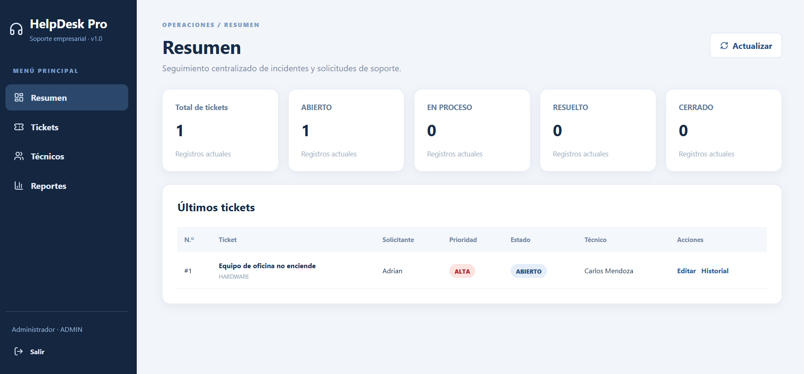
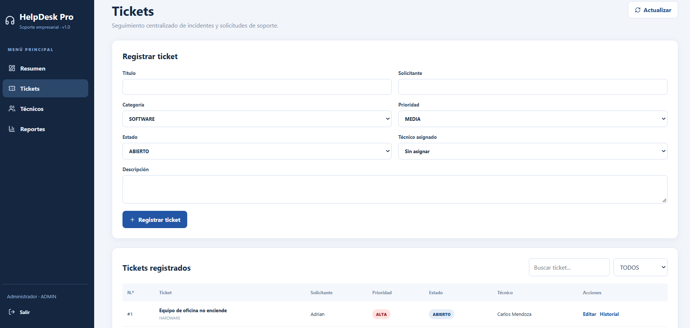
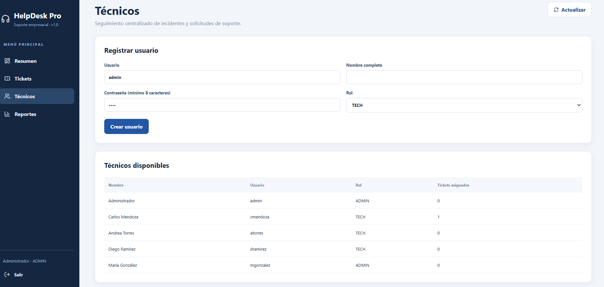
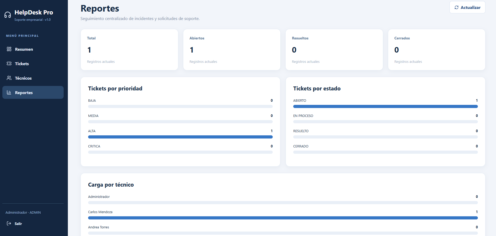

# HelpDesk Pro

**Sistema web de gestión de soporte técnico empresarial** desarrollado como proyecto de portafolio Full Stack.

HelpDesk Pro permite registrar y dar seguimiento a solicitudes de soporte, asignar tickets a técnicos y consultar indicadores operativos mediante un panel de resumen y reportes.

> **Estado:** versión demostrativa 1.0. Las capturas muestran datos de prueba.

## Capturas de pantalla

### 1. Panel de resumen


### 2. Gestión de tickets


### 3. Técnicos y usuarios


### 4. Reportes


## Funcionalidades

- Inicio de sesión y roles de usuario.
- Registro y seguimiento de tickets de soporte.
- Clasificación por categoría, prioridad y estado.
- Asignación de tickets a técnicos.
- Consulta de historial de tickets.
- Gestión de usuarios y técnicos.
- Panel de resumen con métricas de tickets.
- Reportes por prioridad, estado y carga por técnico.
- Persistencia de datos con PostgreSQL.

## Tecnologías

| Capa | Tecnologías |
| --- | --- |
| Backend | Java, Spring Boot, API REST |
| Frontend | React, JavaScript, Vite, HTML y CSS |
| Base de datos | PostgreSQL, SQL |
| Herramientas | Visual Studio Code, Git, GitHub, Maven, npm |

## Requisitos

- Java JDK compatible con el proyecto.
- PostgreSQL en ejecución.
- Node.js y npm.
- Maven Wrapper incluido en `backend` (o Maven instalado).

## Ejecución local

### 1. Base de datos

Crear una base de datos llamada `helpdesk_db` en PostgreSQL (por ejemplo, desde pgAdmin). Verificar que la configuración de conexión del backend apunte a esa base de datos.

### 2. Backend

En PowerShell, desde la raíz del repositorio:

```powershell
cd backend
$env:DB_PASSWORD = Read-Host "Contraseña de PostgreSQL"
$env:HELPDESK_ADMIN_PASSWORD = Read-Host "Contraseña del administrador"
.\mvnw.cmd spring-boot:run
```

El backend utiliza `http://localhost:8082` y se puede comprobar con:

```text
http://localhost:8082/api/health
```

### 3. Frontend

En **otra terminal**, desde la raíz del repositorio:

```powershell
cd frontend
npm install
npm run dev
```

Abrir la dirección local indicada por Vite (habitualmente `http://localhost:5173`). Iniciar sesión con el administrador configurado en el backend.

> **Seguridad:** no incluir contraseñas, tokens, archivos `.env` reales ni respaldos de bases de datos con información privada en el repositorio. La configuración CORS del backend debe permitir el origen local del frontend para el desarrollo.

## Alcance

Este repositorio documenta una **demostración académica/de portafolio** de un sistema de mesa de ayuda. No se presenta como solución lista para producción sin pruebas, endurecimiento de seguridad y configuración adicional.

## Autor

Proyecto personal de desarrollo Full Stack Java.
